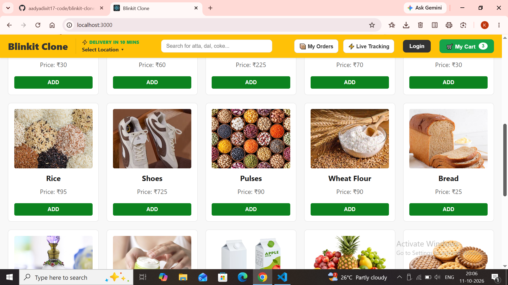
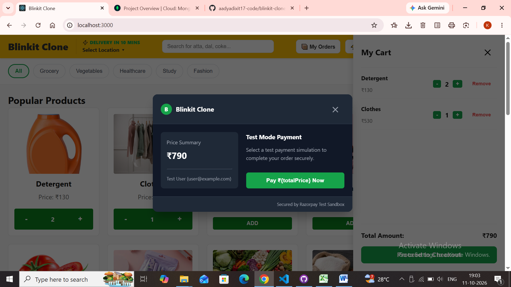
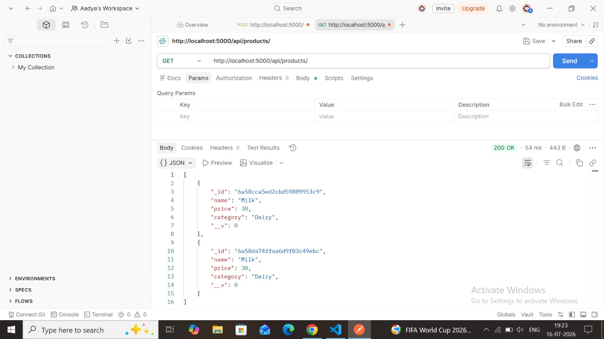

# ⚡ Blinkit Clone (Full-Stack Quick Commerce App)

A feature-rich quick-commerce web application inspired by Blinkit, developed with **React**, **Express.js**, and **MongoDB Atlas**. It features dynamic product browsing, real-time cart state management, and a secure payment gateway workflow.

---

## 🚀 Implemented Features

* **Dynamic Product Catalog & Search:** Fetch and filter products dynamically from a MongoDB database with real-time text searching.
* **Smart Cart Management:** Add, remove, update quantities, and calculate totals instantly using React Context API.
* **Sandbox Payment Flow:** Custom-styled Razorpay sandbox payment modal overlay that transitions seamlessly into an order confirmation success screen and clears user inventory.
* **Cloud Persistence:** RESTful backend endpoints built with Express.js connected securely to a MongoDB Atlas cluster.
* **Thorough API Testing:** All backend API endpoints have been rigorously tested using **Postman**.

---


---

## 🛠️ Tech Stack

* **Frontend:** React, React Router, Context API, Modern CSS
* **Backend:** Node.js, Express.js, Mongoose
* **Database:** MongoDB Atlas (Cloud NoSQL Database)
* **Testing & Tools:** Postman (API Testing), Razorpay Sandbox (Payments)

---

## 📸 Project Showcase

Below is a visual breakdown of the application frontend, payment simulation, API testing, and cloud database storage.

### Application Interface & Payment Workflow
| Dashboard / Storefront | Payment Gateway & Success Screen |
| :---: | :---: |
|  |  |
| *Browse categories, search items, and manage cart inventories.* | *Razorpay sandbox checkout simulation leading to instant confirmation.* |

### Backend API Testing & Cloud Database
| Postman API Validation | MongoDB Atlas Database Cluster |
| :---: | :---: |
|  |  |
| *Rigorously tested REST endpoints for products and orders.* | *Persistent JSON collections securely hosted in MongoDB Atlas.* |

## 🚧 Features In Progress 

To provide full transparency on the project's development roadmap, the following features are actively under development:
* **📦 Order History & Management:** Dedicated `/orders` page to view past orders and detailed item statuses.
* **⚡ Live Delivery Tracking:** Interactive delivery tracking map and estimated delivery countdown timer UI.
* **🔐 Persistent JWT Authentication:** Secure user authentication storing JWT tokens in `localStorage` so refreshing sessions preserves user login status.

---

## ⚙️ Quick Start & Installation

1. **Clone the Repository:**
   ```bash
   git clone [https://github.com/your-username/blinkit-clone.git](https://github.com/your-username/blinkit-clone.git)
   cd blinkit-clone

2. **Configure Environment Variables:**
```bash
Create a .env file inside your server/ directory:
```

3. **Code snippet**
```bash
PORT=5000
MONGO_URI=your_mongodb_atlas_connection_string
RAZORPAY_KEY_ID=your_razorpay_key_id
RAZORPAY_KEY_SECRET=your_razorpay_secret
Install Dependencies & Run:
```

4. **Backend:**
     ```bash
     Bash
     cd server
     npm install
     node server.js
     ```

5. **Frontend:**
     ```bash
     Bash
     cd client
     npm install
     npm start
     ```

## 🛡️ Security Note
Sensitive credentials and local environment files (.env) are excluded from version control via .gitignore to ensure repository safety.